# Chintu

**C**onversational **H**ands-free **I**nterface to **N**etworked **T**erminals & **U**tilities. Your voice. Your computers.

- [Why Chintu exists](#why-chintu-exists)
- [How it works](#how-it-works)
- [What you need](#what-you-need)
- [Install](#install): [phone](#phone-android), [Mac](#mac-apple-silicon), [Ubuntu / Debian](#ubuntu--debian)
- [Pair your phone with a computer](#pair-your-phone-with-a-computer)
- [Using Chintu](#using-chintu) and [permission profiles](#permission-profiles)
- [Troubleshooting](#troubleshooting)
- [Uninstall](#uninstall)
- [Security and privacy](#security-and-privacy)
- [For developers](#for-developers)

## Why Chintu exists

Chintu is a personal voice assistant in the style of Jarvis. It runs on your Android phone and gets real work done on your own computers, a Mac or an Ubuntu machine. You speak, Chintu sends what you said to one of your computers, a Claude Agent SDK runtime on that computer does the work with your own Claude sign-in, and Chintu reads a short answer back to you.

Typical asks:

- "What's in my Downloads folder?" or "Find the PDF I saved yesterday."
- "Take a note" (dictation straight into Markdown files on the computer), then later "Summarise my notes from today."
- Mail, calendar, Slack and quick web research through the connectors and MCP servers set up for Claude Code on that computer. These need the `desktop` profile, see [permission profiles](#permission-profiles).

It is private by design:

- The phone reaches your computers only over your own [Tailscale](https://tailscale.com) tailnet, through Tailscale Serve (HTTPS, tailnet only). Nothing is exposed to the internet.
- The gateway on each computer listens on `127.0.0.1` only.
- Speech recognition and playback happen on the phone with Android's on-device speech services. No third-party speech API is used.
- Permission profiles keep a voice instruction from changing things by accident: the default profile is read-only.

## How it works

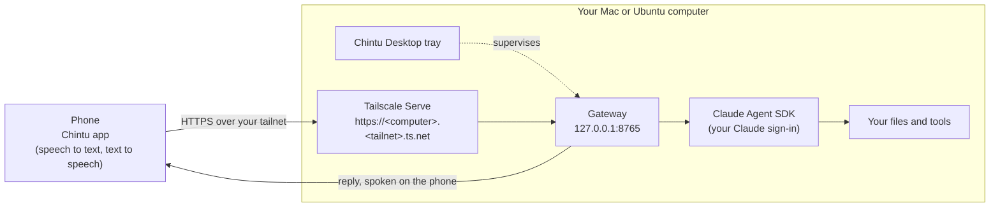

The phone turns your speech into text and sends only the final transcript. The gateway stores the task, runs it through the agent and returns the result, which the phone speaks. The tray app (menu bar on macOS, top bar on GNOME) starts the gateway, shows whether the phone is connected, turns on Tailscale Serve and shows the pairing QR code.

## What you need

- An Android 12 or newer phone.
- [Tailscale](https://tailscale.com/download) on the phone and on every computer, signed in to the same tailnet. In the [Tailscale admin console](https://login.tailscale.com/admin/dns) turn on **MagicDNS** and **HTTPS certificates**; Tailscale Serve needs both.
- On each computer, a Claude Code sign-in: install [Claude Code](https://docs.claude.com/en/docs/claude-code) and run `claude` once to log in. The gateway uses the same `~/.claude` credentials.
- A supported computer: a Mac with Apple silicon, or Ubuntu 24.04 or 26.04 or Debian 13 on amd64 or arm64.

## Install

Packages are published on [GitHub Releases](https://github.com/mohyt/chintu/releases/latest). The latest release is v0.4.2.

### Phone (Android)

1. On the phone, open <https://github.com/mohyt/chintu/releases/latest>.
2. Scroll down to **Assets** and tap `chintu-<version>.apk`, then open the download.
3. If Android asks, allow your browser to install unknown apps.
4. Google Play Protect may say it has not seen this app before. Tap **Scan app** (or install anyway). The APK is signed with the project's release key, so later versions install over earlier ones.
5. Tap **Install** (or **Update** when an older Chintu is already installed).
6. Open Chintu and allow the microphone. Optional permissions: **Nearby devices** to use a Bluetooth headset, **coarse location** only to name your city in the greeting (read once per launch, never stored or sent), and **notifications** for results that finish while the app is in the background.

<p>
  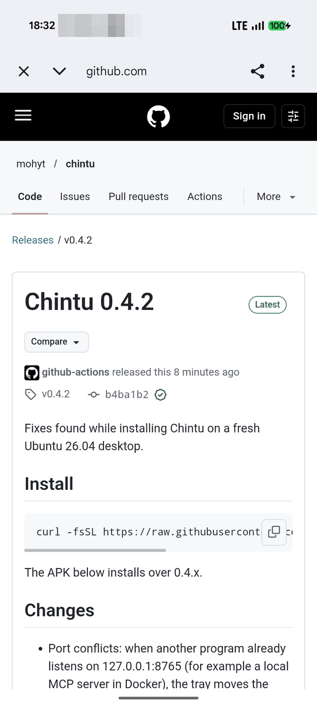
  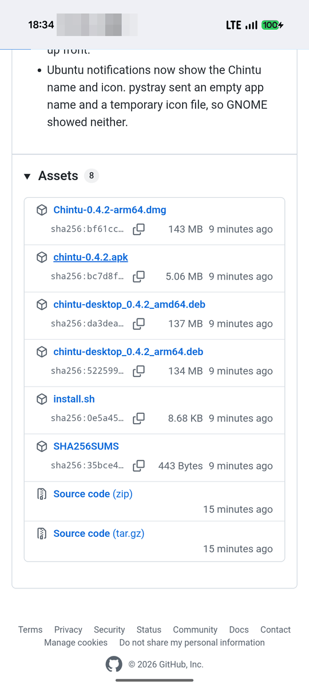
  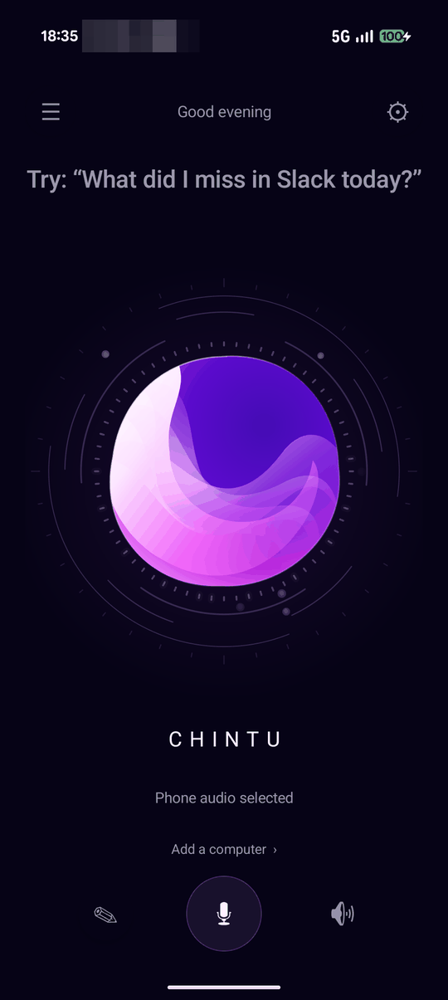
</p>
<p>
  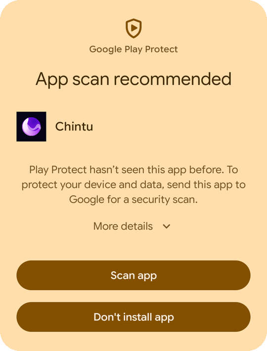
  
  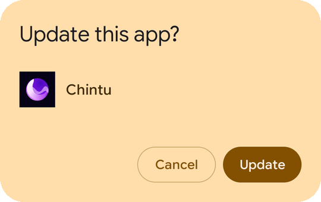
</p>

### Mac (Apple silicon)

1. Install Tailscale from the Mac App Store or [tailscale.com](https://tailscale.com/download/mac) and sign in.
2. In Terminal, run:

   ```sh
   curl -fsSL https://raw.githubusercontent.com/mohyt/chintu/main/install.sh | bash
   ```

   The installer downloads the disk image from the latest release, verifies its SHA-256, copies `Chintu.app` into `/Applications`, clears the quarantine flag (the app is ad-hoc signed, not notarized) and starts it in the menu bar. It ends with hints if Tailscale or the Claude Code sign-in is missing.
3. To start Chintu at login, run `/Applications/Chintu.app/Contents/MacOS/chintu-desktop install-autostart` once.

Manual alternative: download `Chintu-<version>-arm64.dmg` from [Releases](https://github.com/mohyt/chintu/releases/latest), open it, drag Chintu to Applications, and open it the first time with right-click, **Open**.

<!-- TODO: Mac screenshots (menu bar, Enable Tailscale Serve, pairing QR) -->

### Ubuntu / Debian

1. Install Tailscale and sign in: `curl -fsSL https://tailscale.com/install.sh | sh && sudo tailscale up`.
2. Open a terminal **on the computer itself** and run:

   ```sh
   curl -fsSL https://raw.githubusercontent.com/mohyt/chintu/main/install.sh | bash
   ```

   Run it in a real terminal: `sudo` has to ask for your password, which it cannot do over a non-interactive session. The installer verifies the package's SHA-256, installs the `.deb` with `apt`, creates the login item and starts the Chintu tray in the top bar.
3. On GNOME the tray icon needs the AppIndicator extension. Ubuntu ships it enabled; on other GNOME setups see [Troubleshooting](#tray-icon-missing-on-gnome).

`CHINTU_VERSION=0.4.2` in front of `bash` pins a version (for example `curl … | CHINTU_VERSION=0.4.2 bash`). The `.deb` bundles wheels for the system Python 3.12, 3.13 and 3.14, so it installs on Ubuntu 24.04, Ubuntu 26.04 and Debian 13.

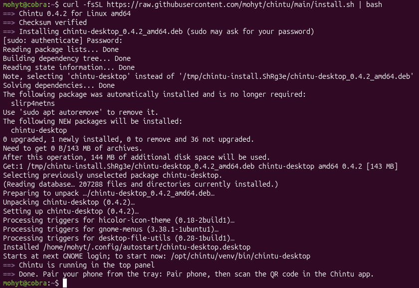

## Pair your phone with a computer

On the computer:

1. Click the Chintu icon in the menu bar (Mac) or top bar (Ubuntu) and choose **Enable Tailscale Serve…**.
2. Choose **Confirm: expose the gateway to the whole tailnet**. This makes the gateway reachable from devices on your tailnet only, not from the internet. A notification confirms the tailnet address.
3. Choose **Show pairing QR**. A window titled "Pair \<Computer\>" shows a QR code. The code works once and expires after 10 minutes; **Refresh** makes a new one.

<p>
  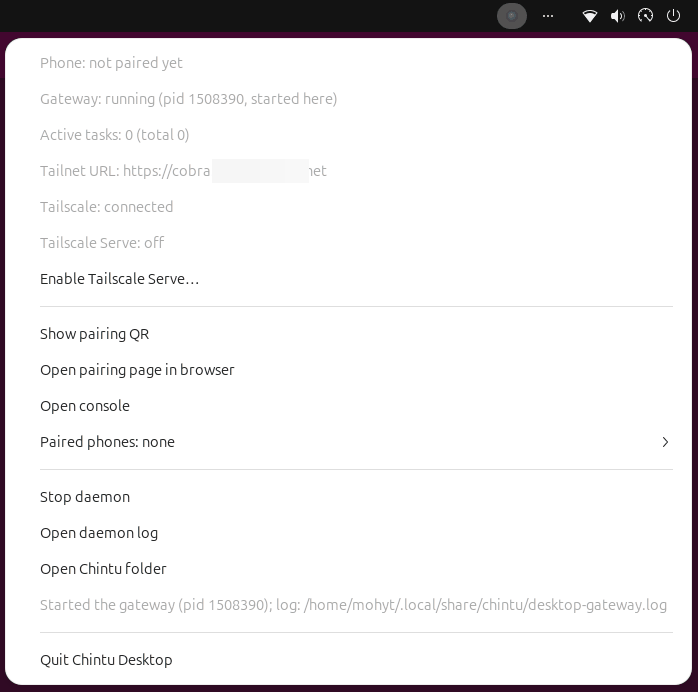
  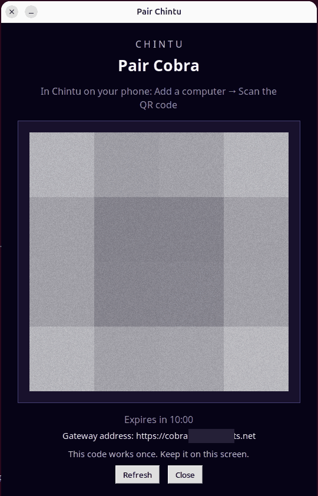
</p>
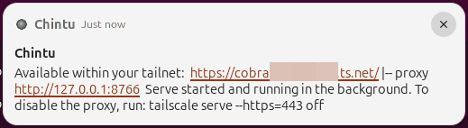

On the phone:

1. Tap the computer selector at the bottom of the home screen (**Add a computer** before the first pairing).
2. Tap **Add a computer**, then **Scan the QR code shown by the computer**. The form fills in the address, name and one-time secret.
3. Adjust the spoken name or add voice aliases if you like, then tap **Save & connect**.

<p>
  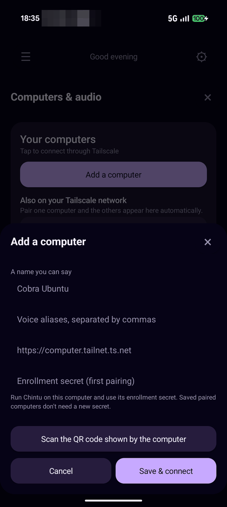
</p>

Pair each computer separately. After the first one, the other computers on your tailnet appear under "Also on your Tailscale network"; tap one to open its pairing form, then scan that computer's QR code. Switch between computers by voice, using their names or aliases: "Chintu, switch to my Mac" or "Chintu, connect me to Cobra".

## Using Chintu

- Tap the mic and speak. Chintu sends the final transcript to the selected computer and speaks the reply. The orb shows what is happening: listening, thinking (while the computer works) and speaking.
- **Stop speaking** stops the audio only. The task on the computer keeps running.
- **Note mode** (✎ on the home screen) dictates into a Markdown note on the computer (by default `~/Documents/Chintu Notes`). Tap ✎ again to finish; Chintu confirms the word count.
- **Quiet mode** (Settings) mutes spoken output and queues instructions; read the results in **Activity** (☰ on the home screen).
- **Automatic sending** is on by default. Turn it off in Settings to review each transcript before it is sent.
- **Hands-free while the app is open** (Settings) keeps listening between turns while Chintu is in the foreground.

A wake word ("Chintu, …" without touching the phone) and always-on background listening are in development and not released yet. Today, use the mic button or the hands-free toggle.

<p>
  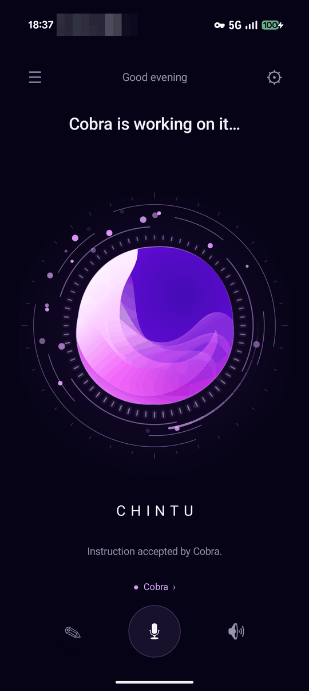
  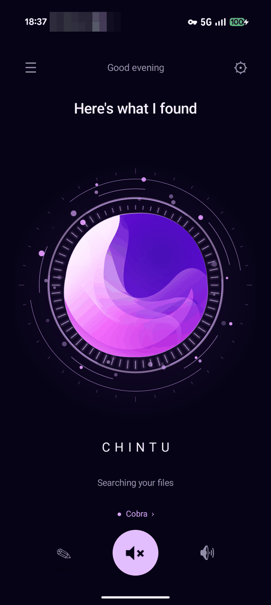
</p>

### Permission profiles

Each task runs under a permission profile that decides what the agent may do on the computer. The workspace is your home folder.

| Profile | What it can do | Available |
| --- | --- | --- |
| `inspect` (default) | Read and search files inside the workspace. Nothing is changed. | Always |
| `develop` | Also create and edit files and run commands, confined to the workspace. | Always |
| `desktop` | Everything Claude Code can do on the whole computer, including connectors (mail, calendar, Slack), MCP servers and web search. | Only when enabled in that computer's `gateway.local.json` |

`inspect` and `develop` allow only file tools (and commands in `develop`), so connectors, MCP servers and web tools are refused there. The confinement is enforced by a hook before every tool call; its exact guarantees and gaps are in [deploy/README.md](deploy/README.md#execution-profiles), which also explains [how to enable `desktop`](deploy/README.md#enabling-the-desktop-profile).

To switch: on the home screen tap the gear (⚙) to open Settings, open the permission profile dropdown and choose `develop`. The home screen then says "\<Computer\> is online in develop mode." The choice is per computer and remembered.

## Troubleshooting

**Ubuntu install fails with `cffi-… is not a supported wheel on this platform`.**
Packages older than 0.4.1 carried wheels for Python 3.12 only, and Ubuntu 26.04 has Python 3.14. Install 0.4.1 or later: rerun the one-liner.

**`sudo: A terminal is required to authenticate`.**
The installer ran without a terminal (for example through a tool or a non-interactive `ssh`). Run it in a terminal on the computer, or with `ssh -t`.

**The tray says the gateway port is in use by another program.**
Something else listens on 8765 (in testing, a Docker MCP server). Since 0.4.2 Chintu moves to the next free port in 8766-8799 automatically and saves it in `desktop.json` in the Chintu folder. Delete that file to go back to 8765. `chintu-desktop status` reports the port in use; `--port` forces one.

**Enable Tailscale Serve fails with "access denied" on Linux.**
Your user is not the Tailscale operator. Run `sudo tailscale set --operator=$USER` once, then choose **Enable Tailscale Serve…** again. The tray and the installer print the same command.

**Tailscale is not installed, signed out or stopped.**
The tray shows which. Install it from [tailscale.com](https://tailscale.com/download), then run `sudo tailscale up` (Linux) or open the Tailscale app and sign in (Mac). The phone and the computer must be on the same tailnet, with MagicDNS and HTTPS certificates enabled.

**The phone says "\<Computer\> is saved but not paired yet".**
The one-time code expired (after 10 minutes) or was already used. On the computer choose **Show pairing QR** (or **Refresh**). On the phone open the computer selector, tap **Edit name, voice aliases & pairing** under that computer, then **Scan the QR code shown by the computer**.

**The agent says it can't write or change files.**
The `inspect` profile is read-only by design. Switch to `develop` in Settings, see [permission profiles](#permission-profiles).

**The phone shows "Refused by the inspect profile: …" while the task still finishes.**
The agent tried something outside the profile, such as a path outside the workspace, and the guard blocked that one step. Switch profiles only if you really want to allow it.

<a id="tray-icon-missing-on-gnome"></a>
**The tray icon is missing on GNOME.**
Enable "AppIndicator and KStatusNotifierItem Support": `sudo apt install gnome-shell-extension-appindicator`, then log out and back in.

**macOS says the app can't be opened or is damaged.**
The app is not notarized. Use the one-liner (it clears the quarantine flag), run `xattr -dr com.apple.quarantine /Applications/Chintu.app`, or open it with right-click, **Open**. There is no published build for Intel Macs; build one with `scripts/package/build-dmg.sh` on an Intel Mac.

**Android says "App not installed" or reports a package conflict.**
An older build signed with a different key (for example a debug build) is installed. Uninstall it once, then install the release APK. Pairings stored on the phone are lost, so pair each computer again.

**An instruction is cut off before you finish speaking.**
Android's recogniser ends on a short pause. This is a known issue being tuned. Speak continuously, or turn off automatic sending in Settings to review the transcript before it is sent.

**Where are the logs and files?**

| System | Chintu folder |
| --- | --- |
| Ubuntu / Debian | `~/.local/share/chintu/` |
| macOS | `~/Library/Application Support/Chintu/` |

The folder holds `gateway.local.json` (configuration), `chintu.sqlite3` (tasks and paired phones), `local.secret` (rewritten on every gateway start), `desktop-gateway.log` (gateway log) and `desktop.json` (only when the port moved). The tray's **Open daemon log** and **Open Chintu folder** open them, and `chintu-desktop status` prints a JSON snapshot of the gateway, Tailscale and Serve state.

## Uninstall

**Ubuntu / Debian**

```sh
chintu-desktop uninstall-autostart
sudo apt purge chintu-desktop
tailscale serve reset          # only if you enabled Serve
rm -rf ~/.local/share/chintu   # optional: configuration, task history, logs
```

**Mac**

1. Quit Chintu from the menu bar.
2. If you installed the login item: `/Applications/Chintu.app/Contents/MacOS/chintu-desktop uninstall-autostart`.
3. Delete `/Applications/Chintu.app`, and optionally `~/Library/Application Support/Chintu`.
4. If you enabled Serve: `tailscale serve reset` (with the Tailscale CLI, for example `/Applications/Tailscale.app/Contents/MacOS/Tailscale serve reset`).

**Phone**

Uninstall the app. Then, on each computer you no longer want to reach from that phone, revoke it from the tray: **Paired phones ▸ Revoke \<name\>…**, then confirm.

## Security and privacy

- The phone talks to a computer only over your tailnet through Tailscale Serve; the gateway binds to loopback and is never exposed to the internet.
- The tray and local pages prove themselves to the gateway with a secret that is regenerated on every gateway start.
- Each phone gets its own token, with an expiry (30 days by default) and revocation from the tray. Tasks are isolated per phone.
- Result notifications are private on the lock screen.
- `inspect` and `develop` are confined to the workspace by a hook that checks every tool call.

Report vulnerabilities as described in [SECURITY.md](SECURITY.md).

## For developers

| Path | What lives there |
| --- | --- |
| [`apps/android/`](apps/android/README.md) | Kotlin app (API 31+): speech, audio routing, pairing, activity and note modes |
| [`apps/desktop/`](apps/desktop/README.md) | Python tray app for macOS and GNOME: presence, QR pairing, gateway supervision, Tailscale Serve, revocation |
| [`services/gateway/`](services/gateway/README.md) | FastAPI gateway on loopback with SQLite task store, pairing, local-proof endpoints and voice notes |
| [`packages/agent-adapters/`](packages/agent-adapters/README.md) | Claude Agent SDK adapter, execution-profile confinement and the scripted fixture |
| [`contracts/`](contracts/) | OpenAPI 3.1 contract, adapter protocol and wire examples |
| `tests/` | Integration tests across gateway and adapters |
| `packaging/`, `scripts/package/` | APK, macOS app bundle and Debian package builds |
| [`deploy/`](deploy/README.md), `config/` | launchd and systemd units, example operator configuration |
| [`docs/`](docs/) | Numbered design documents, validation records and release notes |

Build and test (Python 3.12, `uv`, and a JDK 17 or 21 for the Android core checks):

```sh
make bootstrap                                          # uv venv + hash-pinned requirements-dev.lock
make PYTHON=.venv/bin/python test demo                  # contract, gateway, adapters, integration, Android core logic
.venv/bin/python -m unittest discover -s apps/desktop/tests
python3 apps/android/tools/android.py build :app:assembleDebug :app:lintDebug
```

The Android helper fetches Gradle and the SDK into `apps/android/.tooling/`; see [the Android README](apps/android/README.md). CI ([verify.yml](.github/workflows/verify.yml)) runs the Python suites and the Android build on every push and pull request.

- **Contract first.** Every HTTP route must exist in [`contracts/openapi.json`](contracts/openapi.json) before it is implemented; the gateway validates payloads against it and [`scripts/check_contract.py`](scripts/check_contract.py) checks it in CI. See the [API guide](docs/08-api-contract.md) and the [adapter protocol](contracts/adapter-protocol.md).
- **Packaging and releases.** The root `VERSION` file is the single version; tagging `v<version>` builds and publishes the APK, disk image and Debian packages. See [packaging and releases](docs/11-packaging-and-releases.md).
- **Design documents.** [Requirements](docs/01-requirements.md), [architecture](docs/02-architecture.md), [voice and Android](docs/03-voice-and-android.md), [agents and contracts](docs/04-agents-and-contracts.md), [security and operations](docs/05-security-and-operations.md), [delivery plan](docs/06-delivery-plan.md), [decisions and sources](docs/07-decisions-and-sources.md), [setup and first demo](docs/09-setup-and-first-demo.md), [the Chintu experience](docs/10-chintu-experience.md). Contributor conventions are in [AGENTS.md](AGENTS.md).

## License

[Apache License 2.0](LICENSE). Copyright 2026 Mohit Srivastava.
