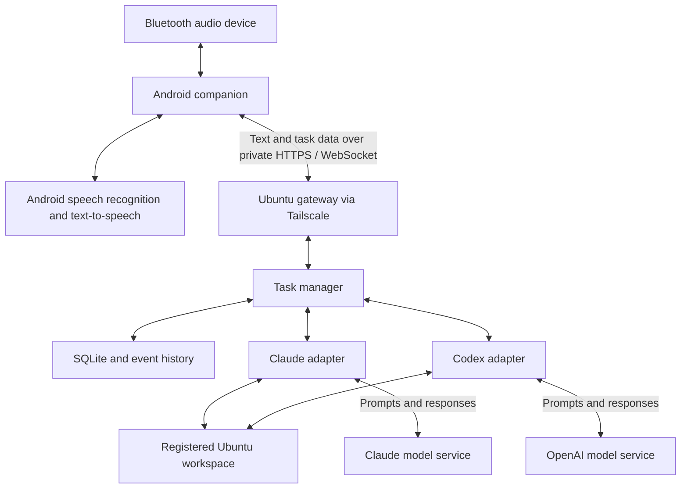
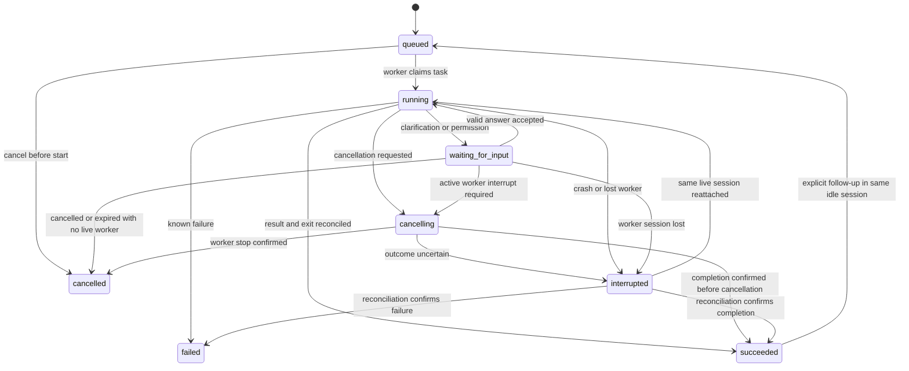

# System architecture

Design v0.2 · 10 October 2026 · accepted direction; implementation pending

## Component model

The diagram describes logical responsibilities. The first implementation can keep the gateway and task manager in one application process, with worker processes isolated from the HTTP request lifecycle. Speech handling belongs to Android. Separate server services are unnecessary until a measured constraint justifies them.

The owner-requested [multi-computer experience](10-chintu-experience.md) repeats this gateway/task-manager boundary per execution computer. Android stores separate credentials, drafts, selections, pending submissions and event cursors for each canonical private URL. An authenticated `/api/v1/systems` request reads the current gateway's local Tailscale peer inventory; it does not forward tokens or execute work on discovered peers. The client changes its active destination only after that host's authenticated catalogs load. Audio routing remains on the phone and is independent of host selection. Current events use HTTP polling; desktop/runtime validation remains per host.

| Component | Owns | Does not own |
| --- | --- | --- |
| Android companion | Speech recognition, TTS playback, audio routes, listening controls, client authentication, task UI, last event cursor | Agent-provider secrets or desktop shell execution |
| Gateway | Authenticated text requests, validation, event subscriptions, task-result delivery | Audio processing or long-lived work tied to an HTTP request |
| Task manager | Durable state, scheduling, workspace locks, approval records, task cancellation | Provider-internal reasoning or undocumented app state |
| Agent adapter | Provider session, streamed events, supported permissions and interrupts | Cross-provider conversation compatibility |
| Persistence | Task metadata, event sequence, approval decisions, output references | A guarantee that arbitrary external side effects are reversible |

## Proposed implementation choices

- Android: Kotlin with `SpeechRecognizer`, `TextToSpeech`, native audio routing, and appropriate foreground-service handling for supported user-enabled background listening. On-device speech availability is tested per device and language.
- Ubuntu service: Python with FastAPI, an asynchronous event loop, and typed internal contracts.
- State: SQLite with transactional writes and an append-only application event table; local output files referenced from records.
- Networking: Tailscale Serve in front of a loopback-bound gateway; application pairing credentials in addition to tailnet access rules.
- Agent control: a common adapter contract over supported Claude and Codex interfaces. See [04-agents-and-contracts.md](04-agents-and-contracts.md).
- Process supervision: a systemd user service for the application and supervised, identifiable worker processes.

These are design proposals, not installed dependencies. Pin actual dependency and CLI versions after the compatibility spike. The first implementation must use the protocol/schema matching those versions.

## Network and data boundaries

| Connection | Route | Data crossing the boundary |
| --- | --- | --- |
| Bluetooth device to phone | Local Bluetooth | Microphone audio and playback, subject to supported profiles |
| Phone to gateway | Tailscale and TLS | Recognized instruction text, selected project/provider, task requests, events, results, approval decisions; no audio |
| Android to installed speech service | On-device processing or engine's network service | Speech recognition and synthesis data, depending on selected engine and language |
| Agent runner to model provider | Provider's supported connection | Prompts, permitted project context, and tool output needed by the agent |
| Adapter to Ubuntu workspace | Local tool/process access | Files, commands, and configured tools within the granted execution scope |

Tailscale makes the phone-to-Ubuntu path private; it does not make agent inference local. Android converts speech into text before submission and converts returned text into speech. No OpenAI speech API or Ubuntu audio relay is part of V1. Android's default speech services are not assumed to be offline; record the actual recognizer, TTS engine, languages, and network behavior.

## Independent conversation and execution lifecycles

A voice session is short-lived. A task is durable. One conversation can refer to multiple tasks, but its selected task must be visible and unambiguous. The V1 default is one active desktop task and a bounded queue; the schema should not assume there can only ever be one.

The Android app sends explicit operations such as submit, status, continue, and request cancellation. V1 uses visible project/task/provider selection and a small recognized command vocabulary; arbitrary task instructions go to the selected agent as text. Ambiguous references require clarification rather than an inferred workspace or shell command. Every call is validated by the gateway against the enrolled client, selected project, and task policy. File text and tool output are data, not fresh user authorization.

The desktop task is acknowledged only after the task record and initial event commit in a single database transaction. The client keeps its submission key until it has received the durable task ID.

## Task lifecycle

`interrupted` means that the prior execution outcome needs investigation. It is not a signal to resubmit automatically. If a provider cannot reattach to a live session, a new attempt is an explicit operation after checking existing effects. Completion/cancellation races are resolved by serialized state updates and recorded evidence; cancellation does not overwrite an already committed success.

The waiting state records whether the task needs an ordinary answer or a permission decision. Those have different contracts and UI treatment. Expiration policy must not result in implicit permission approval.

An explicit follow-up to a succeeded task queues a new attempt in the same supported provider session. It clears the current result while preserving prior outcomes in event history. Task provider/project stay fixed. This is a deliberate new turn, not automatic replay of a completed or uncertain action.

## Data model

| Record | Minimum fields and purpose |
| --- | --- |
| Client | Client ID, owner, credential verifier, enrollment/revocation time, last seen |
| Project | Project ID, canonical workspace path, allowed execution profile, configured tools |
| Conversation | Conversation ID, owning client, project, provider, execution profile, working directory (relative and canonical absolute), latest provider session ID, title, activity time, archived flag |
| Task | Task ID, provider, project, instruction, scope, current state, timestamps, task version |
| Submission | Owner/client scope, idempotency key, canonical request digest, task ID |
| Attempt | Attempt ID, task ID, provider session/thread ID, worker identity, start/end, recovery status |
| Event | Monotonic event ID, task/attempt IDs, event kind, bounded payload, timestamp |
| Input request | Request ID, task/attempt, question or action digest, scope, expiry, resolution |
| Artifact | Artifact ID, task, relative storage path, MIME type, size, creation time |
| Phone speech session | Client-local listening/playback state and audio routes; server retains conversation/task identity, not audio |

### Event delivery

Events are written once, in the SQLite transaction that changes the task. Clients read them two ways from the same table and cursor: `GET /api/v1/events` (polling) and `GET /api/v1/events/stream` (server-sent events over the same Tailscale HTTPS origin). After each committing transaction that stored events, the store notifies an in-process hub that wakes open streams; streams also re-check the table every five seconds, so writers in other processes (operator reconciliation) are delivered too. Because the stream is only a faster read of durable events, losing it, the gateway restarting, or the phone changing networks loses nothing: the phone resumes from its last event ID or falls back to polling (D23). Streams are bounded per client and in total, recycled every 15 minutes, re-authorised every heartbeat, and given three seconds at shutdown.

### Conversations

A conversation is the unit voice and chat share (D22). Each instruction, spoken or typed, is a task submitted with a `conversation_id`; the gateway takes the conversation's latest provider session ID when the worker claims the turn and passes it as `resume`, and every `started` event updates it. Turns therefore continue one agent session in order, and the global single worker keeps them from overlapping. Project, provider, execution profile and working directory are fixed for the conversation's life, because Claude Code stores sessions per working directory and a profile change would change authority mid-session; changing any of them starts a new conversation. A `conversation_id` the gateway has not seen starts a conversation at the workspace root, which keeps older clients working.

The working directory is a folder inside a registered workspace, resolved after following symlinks and `..`; it becomes the task's workspace path, so `inspect` and `develop` confinement narrows to it. Quarantine after an uncertain real-provider outcome blocks every path that contains or lies inside the interrupted task's folder.

Task provider and project remain fixed for an attempt. Explicit provider handoff creates a new task with a user-approved summary; it does not reuse another provider's opaque session identifier.

## Concurrency and recovery

The scheduler serializes writes to the same registered workspace. V1 has one running task by default, which reduces repository conflicts and simplifies desktop resource use. Future parallel coding tasks require separate worktrees and per-workspace locks, with merges treated as separate operations.

Task claim uses a transaction and a worker lease. Leases indicate liveness; lease expiry alone never proves a side-effecting worker has stopped. At startup, the supervisor reconciles recorded worker identity, process start information, and provider session state before dispatching new work into the same workspace. A PID by itself is insufficient because it can be reused.

Mobile disconnection does not cancel accepted tasks. Desktop reboot or application-process death may interrupt tasks; durability preserves the record and permits reconciliation, not guaranteed continuous execution. Initially, interrupted jobs are surfaced for deliberate recovery when safe reattachment cannot be established.

The current implementation uses one serialized worker and an exclusive database worker lock. Uncertain real-provider outcomes mark the task interrupted and quarantine its canonical workspace path; queued work in that workspace cannot start. Offline operator reconciliation records externally confirmed stopping, clears the block, and preserves the interrupted result. It does not reattach or relaunch the old attempt. Real session reattachment and durable process identity/lease supervision remain later capabilities. See [current build evidence](validation/2026-10-10-build-readiness.md).

Events are stored before delivery. Reconnecting clients request events after their last cursor and obtain a state snapshot when their cursor is outside retained history. Duplicate events are harmless to the UI because it de-duplicates by event ID. Gateway mutation requests are idempotent; arbitrary model-generated shell commands and external tools are not assumed to be.

## Files and future repository layout

The owner authorized parallel implementation on 10 October 2026 after agreeing on the text-only data flow. The implementation layout is:

| Path beneath project home | Intended contents |
| --- | --- |
| `docs/` | Requirements, architecture, decisions, implementation plan |
| `contracts/` | Versioned HTTP schemas, examples, and local adapter interface |
| `apps/android/` | Native phone application |
| `services/gateway/` | Authenticated text gateway, task manager, result/event delivery |
| `packages/agent-adapters/` | Provider adapters and normalization contracts |
| `tests/` | Contract, lifecycle, and failure-injection tests |
| `deploy/` | Reviewed service and Tailscale configuration guidance |
| `config/` | Non-secret project settings and workspace registrations |
| `var/` | Local database, logs, artifacts, and bounded worker output; excluded from source control |

Provider and OS-managed credentials keep their supported secure storage locations. Chintu must not copy provider login tokens into project files just to make the directory self-contained.
