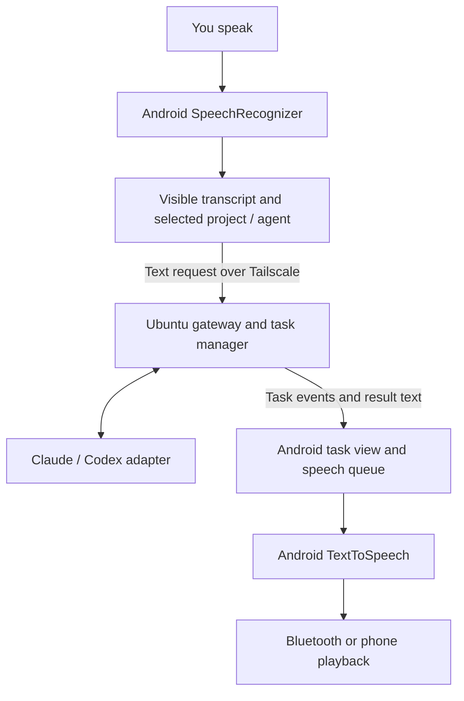

# Voice and Android experience

Design v0.3 · 10 October 2026 · see [implemented experience and device checks](10-chintu-experience.md)

## Audio device compatibility comes first

The user's exact speaker or headset is unknown. A Bluetooth connection alone does not establish microphone support. The hardware investigation must identify both the available input device and the actual playback route.

| Device capability | Intended capture | Intended playback | Test required |
| --- | --- | --- | --- |
| Output-only Bluetooth speaker | Phone microphone | Bluetooth media output | Record while playing/pausing speech; verify routes on this phone |
| Speakerphone or headset with supported communication audio | Bluetooth microphone | Same communication device | Verify input, output, route changes, latency, and intelligibility |
| Bluetooth device disconnected | Phone microphone | Automatic phone speaker fallback | Stop the current utterance before fallback and request repetition |
| Conflicting route or active phone call | Paused capture | Respect system audio focus | Recover cleanly after the call or competing audio ends |

For classic Bluetooth, media playback and hands-free communication are different paths. A media speaker cannot be treated as a microphone. Communication routing can also alter playback quality. Android's communication-device APIs support compatible HFP and BLE audio devices, but actual simultaneous routes must be tested. See sources S1–S2 in [the source ledger](07-decisions-and-sources.md).

The app shows Android's active communication route and waits for confirmation before capture. It does not infer microphone support from a Bluetooth name. The actual recognition-service microphone must still be verified physically; the route display alone is not proof of that service's input selection.

## Listening modes

| Mode | Behavior | Release |
| --- | --- | --- |
| Push-to-talk | User holds or taps a control to record a bounded turn; playback stops when capture starts | V1 baseline |
| Conversation session | Explicit open-app hands-free uses bounded turns; pauses for playback, editing and review; optional automatic final-text send | Implemented, physical turn-taking acceptance pending |
| Wake-word listening | A local keyword engine activates a bounded Android recognition turn during an owner-enabled session | V2 |
| Full duplex | Echo-controlled capture and playback operate together; the user can interrupt naturally | V2 after device tests |

Android allows background microphone capture through a correctly started microphone foreground service with the required permissions. Starting that service while already in the background or at boot is restricted, subject to documented exceptions. The design therefore provides an explicit start action, ongoing notification, and stop control. It does not promise automatic always-listening recovery after reboot or force-stop. See S1.

Wake-word support is a separate engine decision. Select an Android-supported implementation based on measured recognition, licensing, CPU, and battery behavior. Keep wake-word audio local and ephemeral. Detection is an activation signal, not speaker authentication.

“Chintu, connect me to NAME” and “Chintu, switch to NAME” are local commands parsed from final speech during an enabled foreground turn. They select a saved, uniquely named computer after authenticated connection succeeds, and never become task instructions. The animated persona follows recognition/TTS callbacks. Neither this command prefix nor successive foreground recognition sessions is a dedicated background wake detector.

## Accepted speech and text path

Speech recognition and synthesis use Android's installed services. V1 has no OpenAI speech API dependency and sends no audio to Ubuntu. See sources S14–S16 in [the source ledger](07-decisions-and-sources.md).

Use `SpeechRecognizer` for bounded push-to-talk turns. Show the final transcript, support correction, and send final results only; partial recognition must not start tasks. On Android 12+, check `isOnDeviceRecognitionAvailable()` before choosing `createOnDeviceSpeechRecognizer()`. Check language support separately. If on-device recognition is unavailable, show the limitation and retain typing; enabling a network-backed Android recognizer is an explicit configuration choice. `EXTRA_PREFER_OFFLINE` alone does not guarantee offline processing. The standard recognizer is not a continuous wake-word engine.

Use `TextToSpeech` to speak accepted-task acknowledgments, meaningful progress, ordinary questions, and short result summaries. Select an available voice/language, establish its offline/network requirements, and handle initialization or missing-language failures with visible text. Keep code, logs, and long output in the task view. Speak complete sentences from user-facing messages; do not narrate raw tool output or internal reasoning.

Only announce acceptance after Ubuntu commits the task, and only announce success after its outcome is reconciled. Bound the speech queue, associate messages with task/event IDs, and discard obsolete progress. Replayed events rebuild history without automatically replaying every utterance. If recognition or TTS fails, text task controls and accepted jobs remain available.

Starting push-to-talk stops TTS first so playback is not transcribed as a new command. A stop-playback control invokes TTS cancellation locally; task cancellation uses the authenticated gateway. Spoken interruption while TTS is playing requires separately validated listening/echo behavior and is not promised by the half-duplex V1 baseline. Recognition-service microphone routing must be tested directly; a custom recorder's route is not proof that the installed recognizer uses the same microphone.

## Interaction states

| State | User sees/hears | Allowed actions |
| --- | --- | --- |
| Disconnected | Desktop unavailable; last-known tasks marked stale | Retry connection, read cached results, retain an unsent draft |
| Ready | Connected host, selected project, selected provider | Start voice, type, choose a task |
| Listening | Active microphone route and recording indicator | End turn or discard recording |
| Processing turn | Submitted speech is being interpreted | Stop conversation; inspect existing tasks |
| Speaking | Playback indicator and visible text | Stop speaking; begin a new push-to-talk turn |
| Waiting for input | Named task and question | Answer, switch tasks, cancel |
| Approval required | Proposed action and exact requested scope | Approve or deny through the authenticated UI |
| Audio paused | Reason such as call, lost route, or permission change | Re-establish the route and explicitly resume |

Gateway state, agent-provider state, and Android speech state are distinct. An Android speech-service failure must not make an already-running desktop job look failed. A failed desktop task must not be hidden behind successful speech playback.

## Task vocabulary and disambiguation

- “Ask Claude to …” selects Claude for a new task.
- “Ask GPT to …” selects the OpenAI adapter for a new task.
- “Continue that investigation …” targets a visible existing task and its existing provider session.
- “What is running?” reads task-manager state without starting another agent job.
- “Stop speaking” stops playback only.
- “Cancel the investigation” requests cancellation of the resolved task.
- A bare “stop” stops speech immediately; if task cancellation is ambiguous, ask which task to cancel.

Project nicknames are registered explicitly. An unresolved project or task reference results in a short clarification. Never choose a sensitive workspace solely because a transcription roughly resembles its name.

## Approvals and lock-screen behavior

Honor the permissions already granted for the task, so routine steps do not repeatedly interrupt the owner. New permission requests appear as distinct cards with the proposed action and scope. Ordinary clarifications can be answered by voice; granting additional execution privileges uses the authenticated app UI in V1. A spoken “yes” heard from a speaker is insufficient to expand permissions.

The initial lock-screen policy permits visible session controls and status according to Android's notification settings. Newly requested high-impact permissions require unlocking the app. The implementation must respect OS microphone and notification controls; it does not add a hidden listening mode.

## Completion and notifications

An active voice session can speak a concise final result and offer the full output in the task view. Background connected operation may issue a local Android notification when system policy permits it. If the app is suspended or disconnected, results remain on Ubuntu until reconnection.

Guaranteed completion alerts to a disconnected phone are a separate feature requiring a push service or another delivery channel. V1 does not claim that an open WebSocket is an always-available notification mechanism. No email, messaging, or third-party delivery is configured by this design.

## First-device validation

The hardware spike records: phone model and Android version; speaker/headset model and recognition-service microphone path; recognizer/TTS engine and language support; offline tests; capture/playback behavior; effects of calls and media; supported locked-screen behavior; Wi-Fi to cellular handover; measured first-audio latency; and battery drain with the screen off. Foreground-service support alone is not evidence that a third-party recognition engine supports screen-off turns.

Preserve the results as a device compatibility record. Stop expanding voice features until one reliable end-to-end route is demonstrated. Push-to-talk remains available even if wake-word or full-duplex quality is unacceptable on the chosen hardware.
